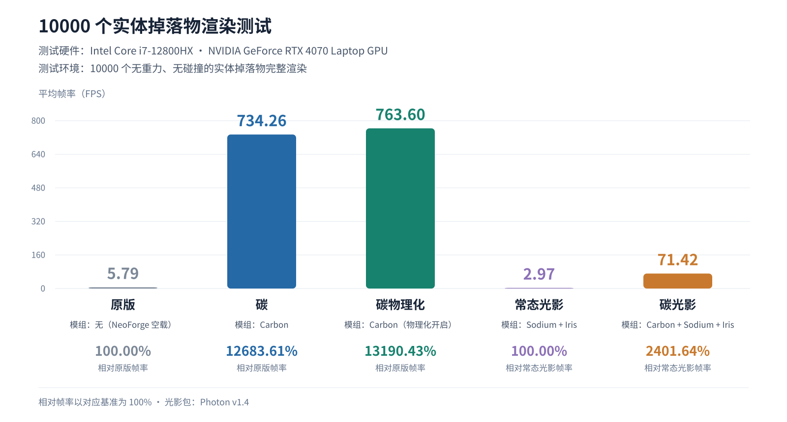

# 10000 个实体掉落物渲染测试

测试硬件：Intel Core i7-12800HX · NVIDIA GeForce RTX 4070 Laptop GPU。

测试环境：10000 个无重力、无碰撞的实体掉落物完整渲染。光影包为 Photon v1.4。

英文版柱状图：[SVG](benchmark/fps-comparison-en.svg) · [PNG](benchmark/fps-comparison-en.png)

| 测试组 | 参与模组 | 平均帧率 | 相对基准帧率（基准为 100%） |
| --- | --- | ---: | ---: |
| 原版 | 无（NeoForge 空载） | 5.79 FPS | 100.00%（相对原版） |
| 碳 | Carbon | 734.26 FPS | 12683.61%（相对原版） |
| 碳物理化 | Carbon（物理化开启） | 763.60 FPS | 13190.43%（相对原版） |
| 常态光影 | Sodium + Iris | 2.97 FPS | 100.00%（相对常态光影） |
| 碳光影 | Carbon + Sodium + Iris | 71.42 FPS | 2401.64%（相对常态光影） |

游戏截图：[原版](benchmark/vanilla-f3.png) · [碳](benchmark/carbon-f3.png) · [碳物理化](benchmark/carbon-physics-f3.png) · [常态光影](benchmark/shader-f3.png) · [碳光影](benchmark/carbon-shader-f3.png)。
