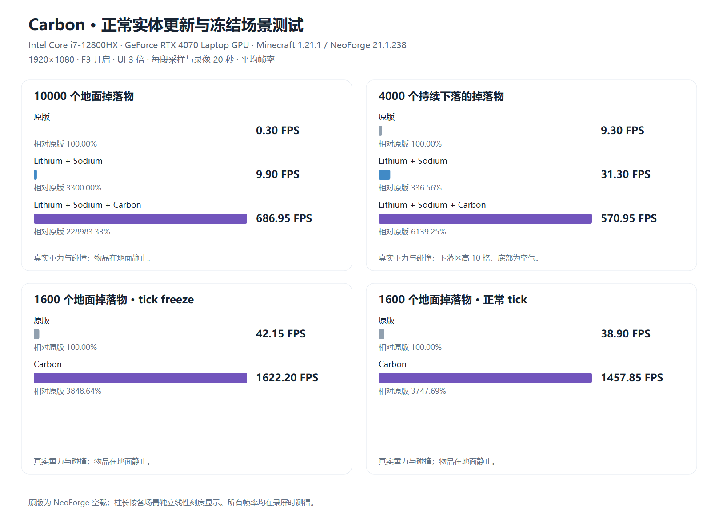

# Carbon 真实实体场景测试

硬件：Intel Core i7-12800HX、NVIDIA GeForce RTX 4070 Laptop GPU。

Minecraft 1.21.1、NeoForge 21.1.238、Carbon 1.21.1.7；Lithium 0.15.4、Sodium 0.8.13。前台全屏 1920×1080、F3 全程开启、UI 3 倍；每段录像 20 秒、60 FPS，表中为同一时间段内游戏实际完成的平均帧率。录像帧率不代表游戏帧率。

所有物品都是未附魔下界合金剑实体，保留正常重力、碰撞；玩家平视，距最近物品超过 10 格。Carbon 使用默认配置，物理化关闭。原版组为 NeoForge 空载。

[SVG 柱状图](fps.svg)

英文纵向版（840 像素宽）：[SVG](fps-en.svg) · [PNG](fps-en.png)

## 10000 个正常重力、碰撞的地面掉落物

| 参与模组 | 平均 FPS | 相对本场景原版 | 录像 | F3 截图 |
| --- | ---: | ---: | --- | --- |
| 原版 | 0.30 | 100.00% | [20 秒录像](videos/ground-vanilla.mp4) | [截图](screenshots/ground-vanilla.png) |
| Lithium + Sodium | 9.90 | 3300.00% | [20 秒录像](videos/ground-baseline.mp4) | [截图](screenshots/ground-baseline.png) |
| Lithium + Sodium + Carbon | 686.95 | 228983.33% | [20 秒录像](videos/ground-carbon.mp4) | [截图](screenshots/ground-carbon.png) |

## 4000 个持续下落的掉落物

物品持续在 y=75 生成，落到 y=65 以下后移除，底部为空气；每游戏 tick 生成 166 或 167 个物品，稳态约 4000 个存活实体。使用 4×4 个下落柱，中心间距 16 格，各柱横向随机范围 3 格。为完整显示该区域，下落组三组统一使用 500% 实体距离，其余场景使用 100%。三组生成规则、视角和实体距离相同。

| 参与模组 | 平均 FPS | 相对本场景原版 | 录像 | F3 截图 |
| --- | ---: | ---: | --- | --- |
| 原版 | 9.30 | 100.00% | [20 秒录像](videos/falling-vanilla.mp4) | [截图](screenshots/falling-vanilla.png) |
| Lithium + Sodium | 31.30 | 336.56% | [20 秒录像](videos/falling-baseline.mp4) | [截图](screenshots/falling-baseline.png) |
| Lithium + Sodium + Carbon | 570.95 | 6139.25% | [20 秒录像](videos/falling-carbon.mp4) | [截图](screenshots/falling-carbon.png) |

服务端稳定维持 4000 个物品。客户端实体数抽样范围：原版 4000～4000；Lithium + Sodium 3896～4000；Lithium + Sodium + Carbon 4000～4000。

## 1600 个地面掉落物：/tick freeze

等待物品自然落地后执行原版 `/tick freeze`；已核对客户端与服务端冻结状态。

| 参与模组 | 平均 FPS | 相对本场景原版 | 录像 | F3 截图 |
| --- | ---: | ---: | --- | --- |
| 原版 | 42.15 | 100.00% | [20 秒录像](videos/frozen-vanilla.mp4) | [截图](screenshots/frozen-vanilla.png) |
| Carbon | 1622.20 | 3848.64% | [20 秒录像](videos/frozen-carbon.mp4) | [截图](screenshots/frozen-carbon.png) |

## 1600 个地面掉落物：正常 tick

与 1600 个物品的冻结组使用相同位置、地面和视角，保持正常 tick 更新。

| 参与模组 | 平均 FPS | 相对本场景原版 | 录像 | F3 截图 |
| --- | ---: | ---: | --- | --- |
| 原版 | 38.90 | 100.00% | [20 秒录像](videos/still-vanilla.mp4) | [截图](screenshots/still-vanilla.png) |
| Carbon | 1457.85 | 3747.69% | [20 秒录像](videos/still-carbon.mp4) | [截图](screenshots/still-carbon.png) |

## 结果说明

正常 tick 的高密度物品堆包含实体碰撞查询、物理与网络更新成本。Carbon 主要优化模型绘制；冻结组则移除了大部分实体更新，不能直接用其帧率代表正常游戏表现。

Carbon 的专用实例化提交不计入原版 F3 的 E 已渲染计数。已另外核对 GPU 实例数：地面组 10000、下落组 4000、两个小场景组均为 1600。

所有正式样本均通过实体数量、重力与碰撞标志、前台焦点、F3、分辨率与 OpenGL 错误检查。详细数值保存在 [results.json](results.json)。
