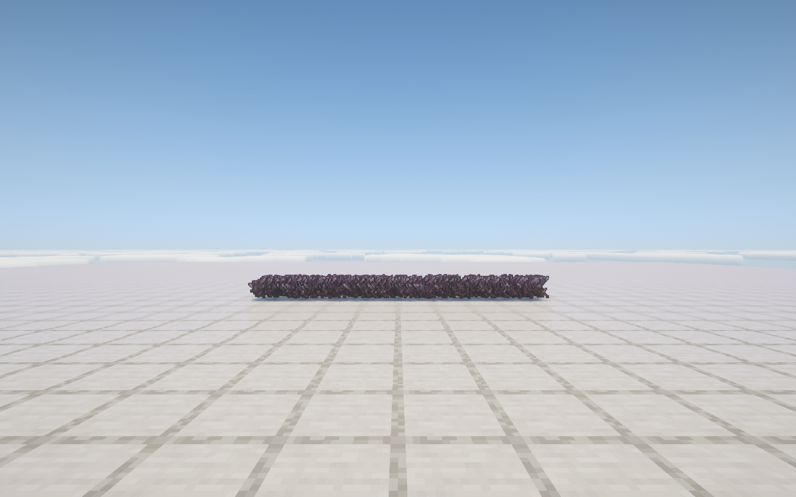
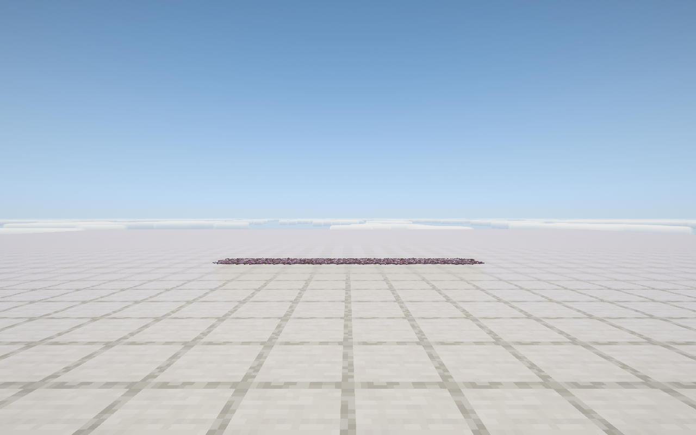

# 26.1.2.8-A 光影兼容测试

最终包在后台用 1000 个正常落地的下界合金剑测试。玩家位置 `(0,200,-10)`，最近距离 11.000092 格，平视、静止，冻结原版客户端与服务端 tick。窗口隐藏，1280×800，不要求焦点，也不重新启动采样。辅助代码不进入交付 Jar。

NeoForge 26.1.2.108、JBR 25.0.4、Iris 1.11.4、Sodium 0.9.2、Complementary Reimagined 5.8.1 HIGH，阴影距离 8 区块。机器为 i7-12800HX / RTX 4070 Laptop。测试 JVM 限制 4 个逻辑处理器、1536 MiB 堆，区块线程 2，以降低并行任务干扰。关闭垂直同步，原版 260 配置值表示不限制帧率。

各路径单次采样 30 秒。1% / 0.1% low 为最慢相应比例帧时间的平均值取倒数。

| 路径 | 平均 FPS | 1% low | 0.1% low | 最长帧 ms |
| --- | ---: | ---: | ---: | ---: |
| 原生 Iris（Carbon 关闭） | 35.40 | 28.02 | 26.55 | 38.26 |
| 26.1.2.8-A | 169.18 | 54.34 | 40.75 | 27.78 |

原生对照通过关闭 Carbon 总开关取得，并非另启 0.8 Jar；0.8 在光影下本就停用这些合批路径。对照来自先前同场景的单次采样，修正扩展顶点捕获后只补测 A，旧 A 成绩不计入最终结果。

两段采样都有其他游戏、渲染与桌面进程活动，且占用不同，不能把数值比值解释成准确的优化倍数或稳定性保证。进程占用按单个逻辑核心为 100% 统计，完整记录见 [results.json](results.json) 与 [raw](raw)。本轮静止样本没有缓存重建，不能用于量化重建 low 帧改善。

功能检查通过：主通道与阴影通道各 1000 实例；56 字节扩展顶点含物品材质 ID `45024`、切线与中点 UV；普通附魔多一份主通道实例，阴影仍为 1000；物理姿态、通用提交、完整可见性检查、光影开关与重载、背包原生回退均无 OpenGL 错误。极小预算下旧实例和阴影持续绘制，预算 0 后队列完成。数据见 [checks.json](checks.json)。

交付 Jar 另在未安装 Iris / Sodium 的环境运行，通过 1000 物品与原版地面阴影检查，顶点恢复为 36 字节。所有检查的累计 OpenGL 错误为 0。只实测上列光影组合；不支持的曲面细分等程序保留原生提交。加载器声明仍为 `[26.1.2,26.2)`，未验证该范围内的最低构建。

审阅修正了捕获阶段缺失 Iris 扩展顶点、首次附魔纹理在 RenderPass 内加载、界面误用世界光影程序及阴影重复提取问题。最终测试未启用产品中的 tick 冻结快速路径。开发环境的 Iris 原生提交缺失 Sampler1 验证项，启动参数仅在测试中使用 `-Dneoforge.disableGlValidation=true`；GPU 错误检查仍开启。早期万物品探查还遇到本机原生内存不足，不采用其成绩。

Jar：`carbon-26.1.2.8-A.jar`，SHA-256：`6fc4d8c2c733344ac485510b03b5a1ac9cec191e8d29473279c53bc24a62aa7b`。测试客户端已退出，辅助模组已移除，运行目录设置已恢复。

