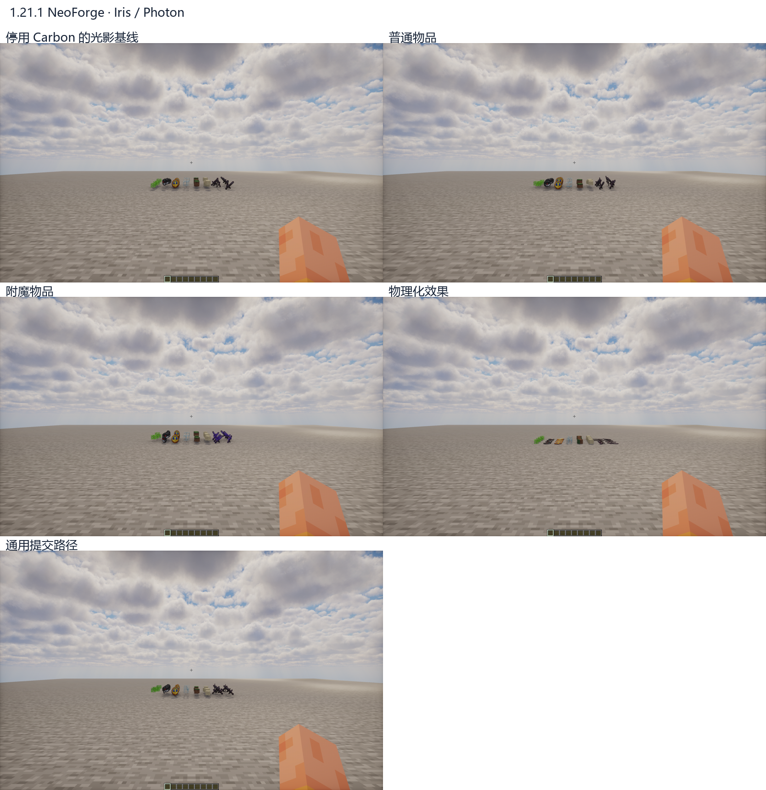

# 光影兼容检查

光影包：Photon v1.4。后台检查普通物品、附魔、物理化及通用提交路径，并与停用 Carbon 的画面对照。

| 游戏版本 | 光影环境 | 结果 |
| --- | --- | --- |
| 1.21.1 NeoForge | Iris 1.8.14-beta.1、Sodium 0.8.13 | 五种模式通过，OpenGL 错误为 0，专用路径实例化正常 |
| 1.20.1 Forge | Oculus 1.8.0、Embeddium 0.3.31 | 修复程序绑定缓存后五种模式通过，OpenGL 错误为 0 |
| 26.1.2 NeoForge | Iris 1.11.4、Sodium 0.9.2 | Photon 当前组合报 `Missing sampler Sampler1`，不能判定为正常兼容环境 |

26.1.2 已分别在 NeoForge 26.1.2.108 和 26.1.2.126 复现；移除 Carbon 后仍发生同一错误，因此该启动问题来自光影组合。此分支的光影路径仍采用原生渲染回退。

1.20.1 修复了原生 `ShaderInstance` 的程序绑定缓存与实例化程序不同步的问题，避免 Uniform 上传到错误程序。修复只调整 Carbon 的程序交接，没有向 Oculus / Iris 类注入 Mixin。

## 1.21.1

## 1.20.1

