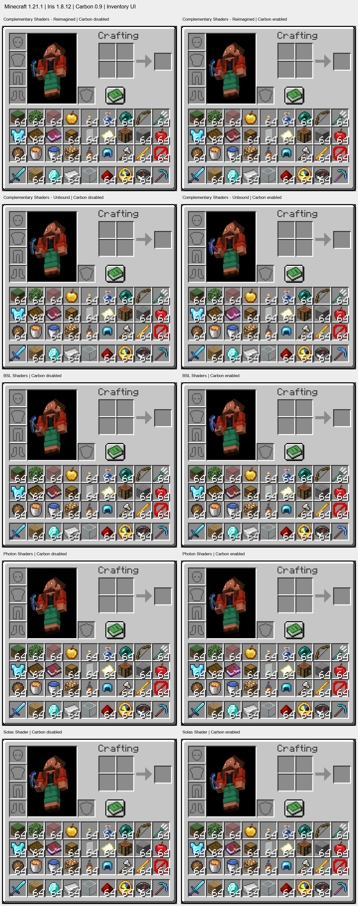

# 0.9 光影物品栏检查

Minecraft 1.21.1、NeoForge 21.1.238、Iris 1.8.12、Sodium 0.6.13、Carbon 1.21.1.9；默认资源，1920×1080，GUI 缩放 4。客户端在隐藏窗口中运行。

光影按 2026-11-04 查询到的 **Modrinth 光影项目累计下载量**排序，取前五项目中支持 1.21.1 / Iris 的最新正式文件。这个排序不等同于 CurseForge 下载排名或活跃使用量。来源、文件地址与 SHA-512 见 [shader-versions.json](shader-versions.json)。

| 排名 | 光影 | 版本 | 项目下载量 | Carbon 关闭 | Carbon 开启 |
| --- | --- | --- | ---: | --- | --- |
| 1 | [Complementary Reimagined](https://modrinth.com/shader/complementary-reimagined) | r5.9.3 | 71,873,107 | [截图](screenshots/reimagined-off.png) | [截图](screenshots/reimagined-on.png) |
| 2 | [Complementary Unbound](https://modrinth.com/shader/complementary-unbound) | r5.9.3 | 46,651,099 | [截图](screenshots/unbound-off.png) | [截图](screenshots/unbound-on.png) |
| 3 | [BSL](https://modrinth.com/shader/bsl-shaders) | 10.1.8 | 31,443,971 | [截图](screenshots/bsl-off.png) | [截图](screenshots/bsl-on.png) |
| 4 | [Photon](https://modrinth.com/shader/photon-shader) | v1.4 | 28,918,865 | [截图](screenshots/photon-off.png) | [截图](screenshots/photon-on.png) |
| 5 | [Solas](https://modrinth.com/shader/solas-shader) | 3.9 | 18,471,982 | [截图](screenshots/solas-off.png) | [截图](screenshots/solas-on.png) |

每款均确认光影处于启用状态，Carbon 开启时实例化可用。物品栏放置 36 种物品，包含立体方块、透明玻璃、树叶、药水、钟、指南针、箱子、旗帜、工具、盔甲与附魔光效；数量覆盖 1 和 64。开启 Carbon 时每帧记录 43–65 次通用模型提交，专用掉落物管线仍收集背景中的 6 个实体。

十张截图中未观察到图标缺失、位置错误、明显染色异常或数量覆盖错误。附魔光效、钟与指南针按时间变化，截图没有锁定这些动画相位，因此不作逐像素一致性结论。Reimagined r5.9.3 在 Iris 1.8.12 下存在 end-flash uniform 警告，关闭 Carbon 时也出现；本次物品栏图标正常。

代码路径检查：UI 可以进入 `ItemBatchRenderer.submit()` 的通用模型实例化，姿态由调用方传入；它不进入仅处理 `GROUND` 的专用掉落物变换。`IrisCompatibility.getBuffer()` 仅为 Iris 批量缓冲源创建适配层，普通 UI 缓冲源保留原通道；世界实体 shader 的替换仅针对这些适配层或掉落物绘制。

本组合未复现物品栏异常，没有据此修改 UI 渲染路径。截图不能排除其他 Iris 版本、光影设置、资源包、自定义模型或其他模组组合的问题。

